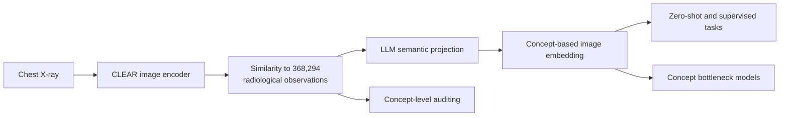

# CLEAR

**Concept-Level Embeddings for Auditable Radiology**

> A medical AI model can be right for the wrong reason. CLEAR makes the reason
> inspectable by grounding chest X-ray representations in radiological concepts.

**Published in _Nature Biomedical Engineering_ on 22 July 2026.**

[Open-access paper](https://www.nature.com/articles/s41551-026-01741-4) |
[DOI](https://doi.org/10.1038/s41551-026-01741-4) |
[Model and concept bank](https://huggingface.co/peterhan91/CLEAR) |
[Code](https://github.com/peterhan91/CLEAR) |
[Citation](#citation)

CLEAR maps a chest X-ray to similarities with **368,294 report-derived
radiological observations**, then projects those concept scores through a large
language model (LLM) embedding space. This makes a prediction decomposable into
weighted contributions from individual observations and supports concept-level
zero-shot classification, model auditing, and concept bottleneck models.

The published model was pretrained on **873,342 image-report pairs from 239,391
patients** and externally evaluated on four physician-annotated datasets from
the United States, Europe, and Asia. In the paper's enlarged-cardiomediastinum
case study, concept auditing exposed reliance on atelectasis-related concepts;
retaining clinically relevant mediastinal concepts and refitting the lightweight
classifier improved AUROC from **0.727 to 0.784** without retraining the image
encoder.



## What is in this repository

- The CLEAR DINOv2 ViT-B/14 image encoder and paired radiology text encoder.
- A Hugging Face-backed loader with the paper's 448 x 448 preprocessing.
- Concept-bank and streaming projection utilities for the full observation
  space without placing every concept embedding on accelerator memory at once.
- Research scripts for benchmarking, zero-shot evaluation, model auditing,
  linear probing, and concept bottleneck experiments.
- Metric utilities for threshold search, F1, Matthews correlation coefficient,
  and bootstrap confidence intervals.

## Installation

CLEAR requires Python 3.10 or newer. Clone the repository and install it in an
environment with a PyTorch build appropriate for your hardware:

```bash
git clone https://github.com/peterhan91/CLEAR.git
cd CLEAR
pip install -e '.[visualization]'
```

The `visualization` extra installs Matplotlib for the plotting utilities. Model
weights are downloaded from Hugging Face on first use and cached locally. The
loader also obtains the DINOv2 architecture code through `torch.hub`; the CLEAR
checkpoint supplies all model weights.

## Quick start: vision-language backbone

`load_pretrained()` downloads the released checkpoint and returns both the model
and the preprocessing transform used for inference:

```python
import torch
from PIL import Image

from clear import load_pretrained, tokenize

device = "cuda" if torch.cuda.is_available() else "cpu"
model, preprocess = load_pretrained(device=device)

image = preprocess(
    Image.open("path/to/cxr.jpg").convert("RGB")
).unsqueeze(0).to(device)
text = tokenize(["pleural effusion", "no pleural effusion"]).to(device)

with torch.inference_mode():
    image_features = torch.nn.functional.normalize(model.encode_image(image), dim=-1)
    text_features = torch.nn.functional.normalize(model.encode_text(text), dim=-1)
    pair_scores = (image_features @ text_features.T).softmax(dim=-1)

print(pair_scores)  # [[positive_score, negative_score]]
```

This is a **backbone demonstration**: it compares one image with two text prompts
in the shared 768-dimensional image-text space. It does not reproduce the full
CLEAR concept projection, auditing experiments, or intervention reported in the
paper.

The same path is available as a command-line example. Adding `--top-concepts`
also retrieves the highest-scoring observations from the complete concept bank;
this option downloads the approximately 1.1 GB text-encoder embedding matrix.

```bash
python examples/quickstart.py path/to/cxr.jpg --top-concepts 10
```

## Full concept pipeline

The full published framework follows four stages:

1. Encode a chest X-ray with the released image encoder.
2. Compute similarities with all 368,294 CLEAR text-encoded observations.
3. Multiply the concept-similarity vector by the aligned LLM concept embeddings
   to obtain a concept-based image embedding.
4. Use that representation for positive-negative zero-shot prompts, supervised
   probes, auditing analyses, or concept bottleneck models.

The released assets are hosted together on
[Hugging Face](https://huggingface.co/peterhan91/CLEAR/tree/main):

| File | Contents | Role |
| --- | --- | --- |
| `best_model.pt` | CLEAR DINOv2 ViT-B/14 image encoder and paired text encoder | Produces 768-dimensional image and text features |
| `mimic_concepts.csv` | Ordered vocabulary of 368,294 radiological observations | Defines the rows shared by both concept-embedding files |
| `concept_embeddings_368294.pt` | 368,294 x 768 CLEAR text-encoder embeddings | Computes image-observation similarity scores |
| `concepts_embeddings_sfr_mistral.pickle` | 368,294 x 4,096 SFR-Embedding-Mistral embeddings | Projects similarity scores into the paper's LLM semantic space |

`ConceptBank.from_files()` supports the released tensor formats. Because Python
pickle can execute code while loading, the SFR asset requires the explicit
`allow_unsafe_pickle=True` opt-in; use that option only with the official,
trusted artifact.

See [`examples/concepts`](examples/concepts) for concept projection, zero-shot,
linear-probing, and concept-bottleneck research scripts, and
[`examples/model_auditing`](examples/model_auditing) for the auditing analyses.
These scripts expose the study workflow but are not a single-command reproduction
of every paper result: they require the released assets, access to the relevant
evaluation datasets, and experiment-specific paths and configuration.

## Reproducibility notes

- Use the released preprocessing returned by `load_pretrained()`; the published
  model was evaluated with 448 x 448 inputs.
- For a fixed model snapshot, pass a specific Hugging Face commit hash through
  the loader's `revision` argument rather than relying on the repository default.
- Keep the concept vocabulary and both embedding matrices in exactly the same row
  order. Misaligned rows invalidate the concept projection.
- The full concept artifacts are large. Plan for sufficient disk and host memory;
  the library streams concept chunks to the selected accelerator.
- Evaluation datasets have their own access requirements and licences. This
  repository does not redistribute the chest X-rays used in the study.
- Exact cohort construction, statistical procedures, and source data are
  documented in the
  [published article](https://www.nature.com/articles/s41551-026-01741-4).

## Intended use and limitations

CLEAR is released for research on chest X-ray representation learning,
concept-level analysis, zero-shot evaluation, model auditing, and interpretable
model development. It is **not a medical device and is not validated for clinical
decision-making**. Predictions and concept attributions require independent
validation for each population, acquisition setting, and task. They should not
be used to diagnose, treat, or triage patients.

The Nature article states that the model weights and full concept bank are
available for academic research. Review the terms accompanying the
[Hugging Face assets](https://huggingface.co/peterhan91/CLEAR) and the licences of
all upstream models and datasets before reuse.

## Repository layout

```text
src/clear/        Core library: checkpoint loader, concept bank, pipeline, and metrics
examples/         Research scripts for benchmarks, concepts, and model auditing
scripts/          Data-preparation and legacy utilities
pyproject.toml    Package and dependency metadata
CITATION.cff      Machine-readable citation metadata
LICENSE           Apache-2.0 licence text
```

## Citation

If you use CLEAR, please cite the published article:

```bibtex
@article{han2026clear,
  author  = {Han, Tianyu and Wu, Riga and Tian, Yu and Khader, Firas and Adams, Lisa C. and Bressem, Keno K. and Davatzikos, Christos and Kather, Jakob Nikolas and Shen, Li and Mankoff, David A. and Barbosa, Jr., Eduardo Mortani and Truhn, Daniel},
  title   = {{CLEAR}: an auditable foundation model for radiology grounded in clinical concepts},
  journal = {Nature Biomedical Engineering},
  year    = {2026},
  doi     = {10.1038/s41551-026-01741-4},
  url     = {https://doi.org/10.1038/s41551-026-01741-4}
}
```

GitHub also reads the machine-readable [`CITATION.cff`](CITATION.cff) file and
offers a **Cite this repository** action.

## License

The code in this repository is released under the Apache-2.0 License. Portions
derived from OpenAI CLIP retain their original copyright notice. Model weights,
concept assets, upstream models, and datasets may be governed by separate terms.

### Indiana CXR subset test on Tesla K80 / CUDA 10.2

From the repository directory on your SSH server (Python **3.10**, git and
internet access required):

```bash
bash scripts/setup_indiana_k80.sh
bash scripts/run_indiana_k80.sh --subset-size 100
```

The dedicated `.venv-k80` pins PyTorch 1.12.1+cu102 and torchvision 0.13.1+cu102
instead of installing the project's modern PyTorch dependencies. The runner uses
`PYTHONPATH=src`, a pinned DINOv2 checkout, disabled xFormers, FP32, and ordinary
attention for PyTorch 1.12. Do not run `pip install -e .` in this environment.
Python 3.10 must already be installed; choose its path with
`PYTHON_BIN=/path/to/python3.10 bash scripts/setup_indiana_k80.sh`.

Default settings: GPUs `0,1`, batch size 2 (one image per GPU), 100 randomly
selected frontal studies, seed 42, original 448×448 preprocessing. This is
zero-shot CLEAR backbone evaluation of cardiomegaly, pleural effusion, pneumonia,
atelectasis and pneumothorax. The first run downloads the **full** Kaggle archive
from the supplied URL and the released CLEAR checkpoint; subsequent runs reuse
local data and model caches. It does not download the large concept bank.

To keep running after disconnecting SSH:

```bash
nohup bash scripts/run_indiana_k80.sh --subset-size 100 > indiana-launch.log 2>&1 &
tail -f indiana-launch.log
```

Each run saves `subset.csv`, `predictions.csv`, `metrics.json`, and `run.log` in a
new `results/indiana_<UTC timestamp>_<PID>/` directory. Predictions include report
fields, image paths, reference tags and paired-prompt scores. Metrics include
per-disease AUROC, average precision, F1 at 0.5, class counts, runtime and GPU
information. Single-class subsets receive `null` AUROC/AP. The scores are not
calibrated clinical probabilities. Labels come from exact semicolon-separated
`Problems` tags, with absent tags treated as negative; these are weak study-level
annotations. This random subset is an exploratory check, not a published test
split or a reproduction of the full CLEAR concept/auditing benchmark.

Additional commands:

```bash
# Choose two physical GPUs and a larger subset.
CUDA_VISIBLE_DEVICES=1,2 bash scripts/run_indiana_k80.sh --subset-size 500
# Reduce memory use; with batch size 1 only one GPU handles each batch.
bash scripts/run_indiana_k80.sh --batch-size 1
# Use already extracted data or a local checkpoint.
bash scripts/run_indiana_k80.sh --data-dir /path/to/indiana --checkpoint /path/to/best_model.pt
# Download and save only the subset manifest, without loading a model.
bash scripts/run_indiana_k80.sh --prepare-only
```

If Kaggle blocks the anonymous API request, download the archive from
[the dataset page](https://www.kaggle.com/datasets/raddar/chest-xrays-indiana-university)
using your account and extract it under `data/indiana/`. The runner finds the two
CSV files and PNG images recursively. GPU kernel checks run before model loading;
actual compatibility and memory use must still be verified on the SSH server.
The CUDA wheel versions follow [PyTorch's official previous-version instructions](https://pytorch.org/get-started/previous-versions/#v1121).
